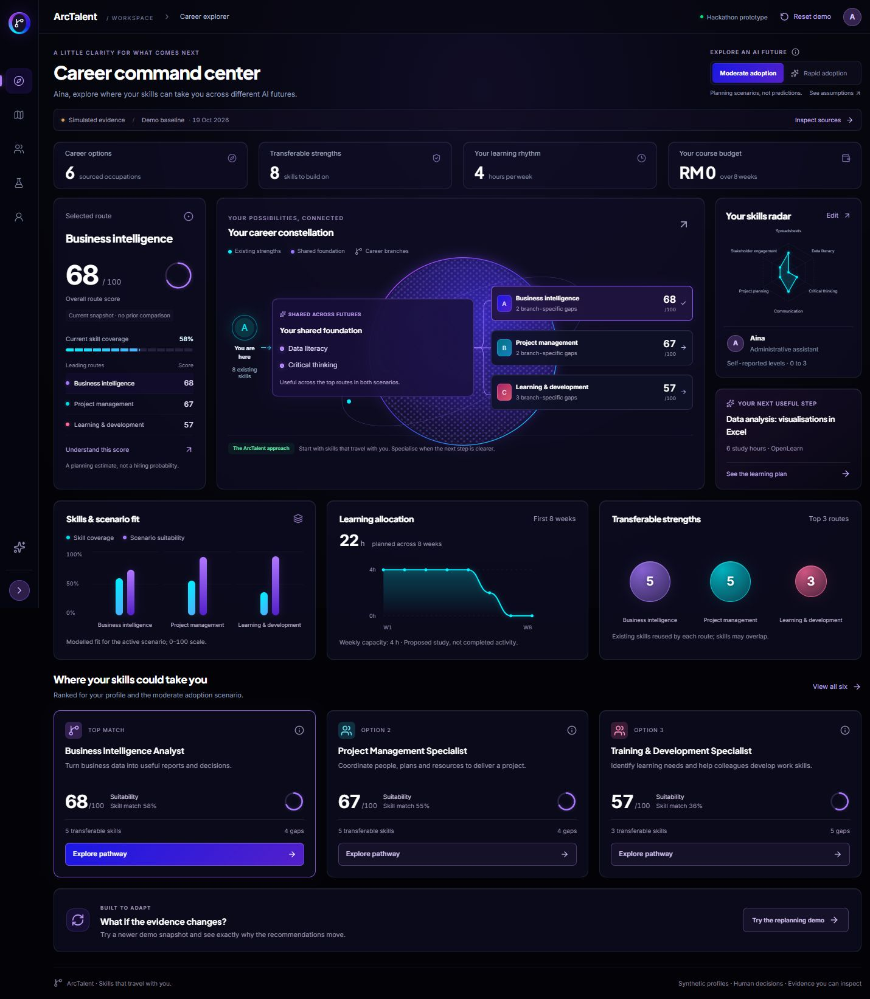

# ArcTalent

**Skills that travel with you.** A hackathon prototype that helps working adults and SME learning managers choose a practical reskilling route under two possible AI adoption scenarios.

**[Open the live ArcTalent demo](https://arc-talent--emmanuelheng.replit.app/)** · [Team Replit project](https://replit.com/@EmmanuelHeng/ArcTalent)

Enter skills, interests, weekly learning time and budget. ArcTalent explains adjacent career matches, highlights the foundation shared across both scenarios, then schedules verified learning resources within the available time. A dated evidence update recomputes the same model and shows exactly what changed.



## Run locally

Requires Node.js 22 or newer.

```sh
npm ci
npm run dev
```

Open http://localhost:3000. No API key or database is needed for the core demo.

```sh
npm run typecheck
npm test
npm run build
npm run start
# In another terminal, with the production server running:
npm run test:integration
```

`npm run format` formats the editable source. CI checks formatting, types, the engine, the production build and the API integration flow. Webpack is selected explicitly for reliable Windows builds.

## Try the demo

1. Reset the demo to Aina: four learning hours per week, RM0 course budget and an eight-week horizon.
2. Open **My learning pathway**. Moderate adoption leads with Business Intelligence Analyst. The shared foundation is data literacy and critical thinking.
3. Switch to **Rapid adoption**. Project Management Specialist becomes the leading route; the later courses change while the foundation stays highlighted. Keep “Follow the leading recommendation” checked for this demonstration. Choosing a destination manually pins it.
4. Open **Evidence lab → Apply newer demo snapshot**. Inspect the dated source fixture and the score differences. This replay is explicitly simulated.
5. Open **SME workspace** for eight synthetic workers, a role-specific gap heatmap, internal capacity controls, grouped training and planned SDG activities.
6. Try **My skills & profile** with the supplied [TXT](public/synthetic-cv.txt) or [PDF](public/synthetic-cv.pdf). Confirm synthetic data and review every detected skill before using it.
7. Try **Start the quick check** in the profile. Review three optional preferences, apply them to the draft, adjust interests if needed, then save. In the pathway, inspect the transferable skill bridge and study-session guidance. Reset before repeating the baseline scenario demonstration.
8. Use the header language selector to switch between **English**, **Bahasa Melayu** and **简体中文**. The browser remembers your choice. Language changes preserve drafts and planning settings; names, CV evidence, original resource titles and exported data remain unchanged.
9. Open **Ask ArcTalent** in the lower-right corner. Ask about the selected career, learning steps, skill gaps, time, budget, funding, scenarios or evidence. Change the scenario and ask again to compare the reply context. The guide runs locally using the current planning data; it is not a language-model service.
10. Open **Settings** using the sliders icon in the header or desktop rail. Choose the interface language, larger reading text or reduced motion, edit learning preferences, download the current plan, or reset demo data after confirmation. Display preferences are saved separately in this browser; resetting demo data keeps them.

See the timed [demo script](docs/DEMO.md), [editable implementation plan](docs/IMPLEMENTATION_PLAN.md), [feature acceptance matrix](docs/FEATURE_ACCEPTANCE.md) and [submission checklist](docs/SUBMISSION.md).

## What is implemented

- Six sourced occupations, sixteen transferable skills, eleven public learning resources and eight fictional employee profiles.
- Deterministic, explainable matching and moderate/rapid scenario comparison.
- An Orion-inspired dark command center with an interactive career constellation, shared learning stops, prerequisites, time and budget limits, weekly schedules and JSON export.
- Read-only score gauges, skill/scenario comparison bars, a weekly allocation chart and proportional skill-reuse bubbles, all derived from the existing engine output. Snapshot deltas name their comparison; no growth history is invented.
- Synthetic TXT/text-PDF import, evidence-backed skill candidates and manual confirmation.
- An optional three-question preference check, a current/target skill bridge and study-session guidance. Preferences are saved with the profile and included in the pathway export; they do not establish aptitude or proficiency.
- Browser persistence for the worker profile, selected scenario, evidence snapshot, course activity, destination preference and manager budget/opening/destination settings.
- English, Bahasa Melayu and Simplified Chinese interface options, including skill/role labels, explanations, charts and profile controls. Translation dictionaries run locally without an external service; unknown source text retains its original wording.
- A floating career and learning guide in all three languages. Replies explain the current selected route and filtered plan, link to catalogue sources and open relevant views. Up to 20 questions stay in memory in the current tab; closing preserves them and clearing removes them. New replies use current data while older replies retain their original context.
- Multilingual Settings for language, reading text, reduced motion and demo-data controls. The native dialog preserves the active workspace and unsaved profile draft; device reduced motion is respected. No account is required.
- A workforce heatmap, proposed internal openings, grouped training, CSV export and planned SDG contribution view.
- Dated synthetic replay plus a real refresh adapter for Arbeitnow job postings and arXiv AI research, with source dates and partial-failure handling.
- Optional RunPod-hosted model extraction through the AI SDK. The default mode uses local alias matching and labels it clearly.

## How the model works

The shared TypeScript engine in `src/lib/engine.ts` powers the browser and `/api/analyze`.

`Suitability = 55% current skill coverage + 15% interest + 15% evidence signal + 15% scenario suitability`

- Skill coverage compares self-reported levels 0–3 with a simplified role requirement model. Pivot distance is 100 minus coverage.
- Interest is 100 for a matching work-family preference and 40 otherwise.
- The optional check initially replaces interests with one explicitly chosen focus; manual interest edits then take priority. Practice format and session length only change study guidance. They never alter course durations, skill levels or score weights.
- Scenario suitability is `1 − adoption factor × role exposure`. Moderate uses 0.35; rapid uses 0.75. Exposure values and weights are illustrative team-model parameters. They require calibration and are not unemployment probabilities.
- Shared foundation means missing skills required by every role in the top three of **both** scenarios. It can change when a profile or evidence snapshot changes.
- The planner expands prerequisite skills and greedily selects useful course coverage per study hour, weighting shared skills first. It respects course prerequisites, total course fees and weekly capacity. It is a heuristic rather than an optimal solver.
- For scheduling only, a mapped course is assumed to cover a skill up to level 2. This is a simplification requiring validation. Marking a course studied never changes the person's self-reported proficiency or matching score. Uncovered gaps remain visible.
- Live market input is `min(1, 0.5 + skill-mention share)` for at least 30 valid job records; smaller samples receive neutral 0.5. This measures visibility in a small Europe-focused sample. It cannot establish demand growth or Malaysian vacancies. Research records provide context and do not change automation assumptions automatically.

The initial and newer demo snapshots are synthetic fixtures dated 19 and 22 October 2026. A comparison always holds the current profile and scenario constant so the evidence contribution can be inspected.

## Architecture and data

Next.js App Router, React, TypeScript, CSS and Lucide icons. Route handlers run on Node.js:

| Endpoint            | Purpose                                                                   |
| ------------------- | ------------------------------------------------------------------------- |
| `GET /api/health`   | Model version and actual extraction mode                                  |
| `POST /api/analyze` | Validated matching and learning plans                                     |
| `POST /api/extract` | Confirmed synthetic text → skill candidates                               |
| `POST /api/pdf`     | Confirmed synthetic text PDF → text; 5 MB / 10 pages maximum              |
| `GET /api/signals`  | Fixed public feed adapters, bounded records and five-minute process cache |

Profiles, completed activity and manager planning settings are stored only in this browser's local storage. CV text is not intentionally saved by the app server. A configured RunPod extractor receives the submitted synthetic CV text. Do not use real CVs in this public hackathon prototype. The app has no accounts, database, production HR controls, OCR, validated psychometric assessment or audited employment-outcome model. PDF import requires readable text.

Occupational descriptions come from US O*NET context, while learning-resource facts are checked against provider pages. Course-to-skill and SDG mappings are project interpretations. No verified HRD Corp programmes have been added: the HRD filter correctly shows an empty state. Do not claim provider registration establishes programme claimability. [Sources and limitations](docs/SOURCES.md).

## Replit and optional RunPod

Import this GitHub repository into the team's own Replit project. The included `.replit` starts port 3000 and defines a production build/start command. Run the project, check the preview and preserve genuine account/project evidence for the hackathon. Replit import and deployment are **not verified by the local build**.

The [live Replit deployment](https://arc-talent--emmanuelheng.replit.app/) was verified on 23 October 2026. The acceptance revision passed 32 unit tests, a production build, type checking and 14 production API checks inside Replit; all 14 API checks also passed against the final public release without authentication. Browser checks confirmed scenario switching, dated evidence replay, retained SME settings, fresh CV evidence and clean synthetic PDF import. The [replit-runtime branch](https://github.com/MantouOP/ArcTalent/tree/replit-runtime) preserves the workspace launch configuration and recovery history. See the [Replit runtime status](docs/REPLIT_STATUS.md) for the exact release, served-file checksum, CI evidence and Starter hosting expiry.

For optional AI extraction, deploy a compatible model on RunPod, then configure server secrets using `.env.example`:

```dotenv
RUNPOD_BASE_URL=https://YOUR-POD-ID-YOUR-PORT.proxy.runpod.net/v1
RUNPOD_API_KEY=YOUR_SERVER_SIDE_KEY
RUNPOD_MODEL=YOUR_EXACT_SERVED_MODEL_ID
```

The HTTPS RunPod proxy endpoint must support OpenAI-compatible chat completions and structured output for the installed AI SDK. Use the actual endpoint and model ID shown by your deployment. This optional integration has not been exercised against a paid GPU instance. Invalid configuration, timeout, unsupported output or the small demo request limit falls back to labelled local matching. No keys belong in GitHub or `NEXT_PUBLIC_*` variables.

## Ownership, declaration and license

This source was created with substantial AI assistance through Codex. The team must review, understand, adapt and accurately declare the assistance before submission; this README does not certify that review has happened. See the editable [tools declaration](docs/TECHNICAL_DECLARATION.md). Commit history records actual development events and does not simulate individual team contributions.

Project code is licensed under [Apache License 2.0](LICENSE). External course content, source data, trademarks and dependencies retain their own rights and licenses. No handbook or course content is redistributed in this repository.
